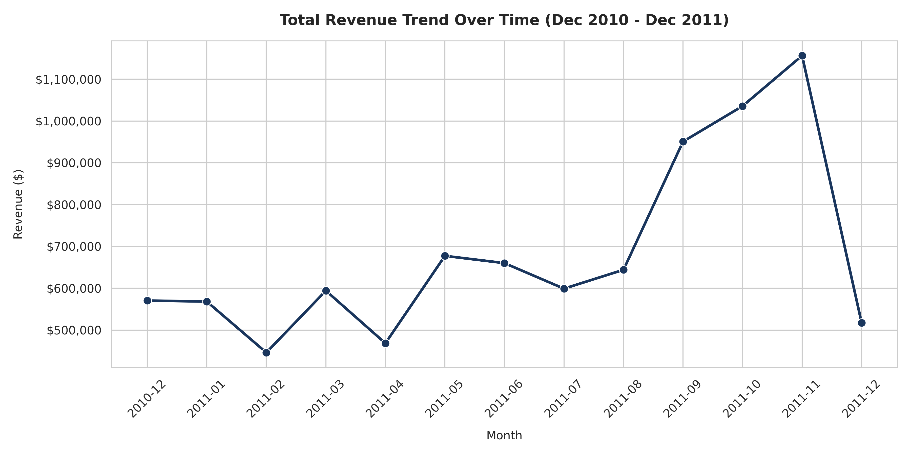
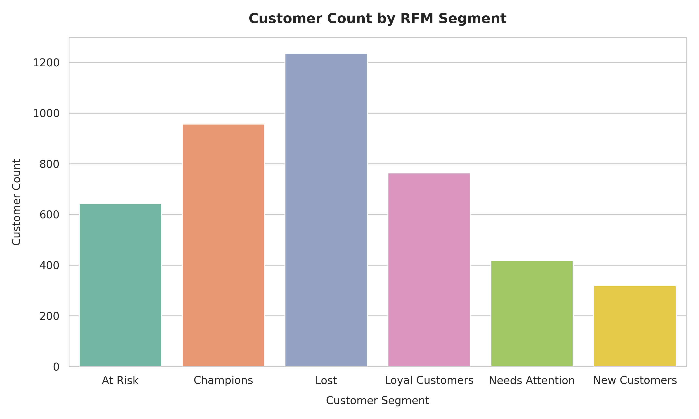
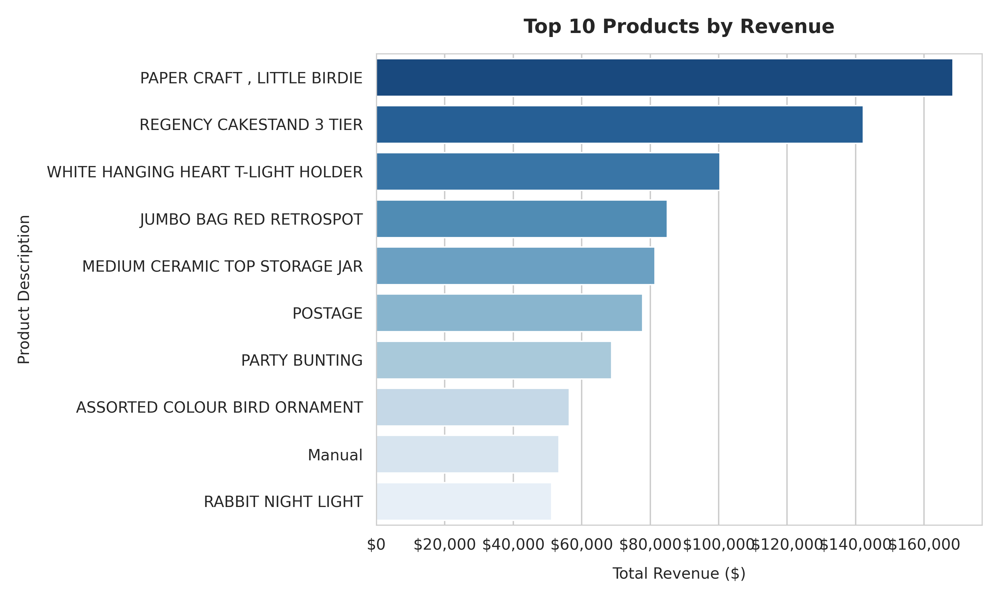

# 🛒 Retail Sales Performance & Customer Segmentation Dashboard


An end-to-end enterprise data engineering and analytics solution built on the **UCI Online Retail II dataset**. This capstone project covers data extraction, EDA cleaning in Python, normalized relational data warehouse design in PostgreSQL, advanced SQL analytical modeling (RFM segmentation, window functions), DAX measures, and a 3-page interactive Power BI dashboard.

---

## 📐 Project Architecture & Workflow

```
[Raw UCI Dataset] ──> [Python Pandas EDA & Cleaning] ──> [Clean CSV]
                                                                │
                                                                ▼
[Power BI Dashboard] <── [Power BI DAX Star Schema] <── [PostgreSQL Data Warehouse]
  ├─ 1. Sales Overview     ├─ sales_fact (Fact View)       ├─ customers (Dim)
  ├─ 2. Segmentation       ├─ date_dim (Dim Table)         ├─ products (Dim)
  └─ 3. Product Performance├─ customer_segments (View)     ├─ orders (Header)
                           └─ v_kpi_summary (View)         └─ order_items (Line Fact)
```

---

## 🗄️ Relational Schema Diagram (PostgreSQL)

```
       CUSTOMERS                     ORDERS                    ORDER_ITEMS
┌────────────────────┐       ┌────────────────────┐       ┌────────────────────┐
│ PK customer_id (INT)│ 1 ──* │ PK order_id (VARCHAR)│ 1 ──* │ PK order_item_id   │
│    country (VARCHAR)│       │ FK customer_id (INT)│       │ FK order_id        │
│    first_order_date│       │    order_date       │       │ FK product_id      │
└────────────────────┘       │    country         │       │    quantity        │
                             └────────────────────┘       │    unit_price      │
                                                          │    line_revenue    │
       PRODUCTS                                           └────────────────────┘
┌────────────────────┐                                               │
│ PK product_id (STR)│ 1 ────────────────────────────────────────────┘
│    description     │
│    unit_price      │
└────────────────────┘
```

---

## 💻 Tech Stack & Deliverables

- **Language:** Python 3.10 (Pandas, Matplotlib, Seaborn, SQLAlchemy)
- **Database:** PostgreSQL / MySQL / SQLite (`psycopg2`)
- **BI Tool:** Power BI Desktop (DAX Time Intelligence, Star Schema Modeling)
- **Files Included:**
  - `Retail_Sales_Performance_EDA.ipynb`: Colab notebook for data exploration.
  - `cleaned_online_retail.csv`: Processed dataset exported from Phase 1.
  - `load_data.py`: Automated Python loader populating normalized SQL tables.
  - `sql/all_retail_pipeline.sql`: Unified SQL script containing DDL schema, cleaning views, RFM segmentation, and analytical KPI views.
  - `dax/06_dax_measures.dax`: Production DAX formulas.
  - `FINAL_REPORT.md`: Comprehensive executive business report.

---

## 🚀 Quick Start & Database Restoration Guide

### 1. Requirements & Setup
```bash
# Clone or navigate to the repository
cd "Rertail Sales performance"

# Install Python dependencies
pip install pandas numpy matplotlib seaborn sqlalchemy psycopg2-binary openpyxl
```

### 2. Run Data Acquisition & Cleaning (Phase 1)
```bash
python eda_script.py
```
*Outputs: `cleaned_online_retail.csv` and high-resolution chart images in `eda_charts/`.*

### 3. Initialize PostgreSQL Database & Load Data (Phase 2 & 3)
Ensure your PostgreSQL server is running and database `retail_dw` is created:
```sql
CREATE DATABASE retail_dw;
```
Then execute the automated Python load script:
```bash
# Set DB connection env vars (optional, defaults to localhost:5432)
export DB_USER=postgres
export DB_PASS=yourpassword
python load_data.py
```

Alternatively, run the master SQL pipeline directly in `psql` or `pgAdmin`:
```bash
psql -U postgres -d retail_dw -f sql/all_retail_pipeline.sql
```

---

## 📊 Power BI Connection & Modeling Instructions (Phase 6 & 7)

### Step 1: Connect Power BI to PostgreSQL
1. Open Power BI Desktop -> **Get Data** -> **PostgreSQL Database**.
2. Server: `localhost` | Database: `retail_dw`.
3. Select Data Connectivity mode: **Import**.
4. Import the following views/tables:
   - `sales_fact` (Fact Table)
   - `date_dim` (Date Dimension)
   - `customers` (Customer Dimension)
   - `products` (Product Dimension)
   - `customer_segments` (RFM Dimension View)
   - `v_kpi_summary` & `v_top_bottom_products`

### Step 2: Configure Data Model Relationships
In the **Model View**, establish the following 1-to-Many (`1:*`) single-direction relationships:
- `date_dim[full_date]` (1) ───> `sales_fact[full_date]` (*)
- `customers[customer_id]` (1) ───> `sales_fact[customer_id]` (*)
- `products[product_id]` (1) ───> `sales_fact[product_id]` (*)
- `customers[customer_id]` (1) ───> `customer_segments[customer_id]` (1:1)

---

## 🖼️ Dashboard Preview & Page Specifications

### Page 1: Sales Overview
- **Header KPI Cards:** Total Revenue (`$8.89M`), Total Orders (`18,532`), AOV (`$479.56`), Repeat Purchase Rate (`65.5%`).
- **Visual 1:** Monthly Revenue Trend (Line Chart with target trendline).
- **Visual 2:** Top 10 Countries by Revenue (Horizontal Bar Chart).
- **Visual 3:** Top 10 Products Leaderboard (Data Table).
- **Slicers:** Date Range Picker (Between Slicer), Country Dropdown.



---

### Page 2: Customer Segmentation (RFM Analysis)
- **Visual 1:** Customer Count & Revenue by RFM Segment (Donut Chart / Clustered Bar).
- **Visual 2:** Recency vs Frequency Scatter Plot (X: Recency Days, Y: Order Frequency, Color: Segment Label).
- **Visual 3:** Segment Financial Summary Matrix (Columns: Customer Count, Total Revenue, Avg Order Value, Churn Risk).
- **Drill-Through:** Right-click customer to view individual order transaction history.



---

### Page 3: Product Performance & Retention
- **Visual 1:** Top 10 vs Bottom 10 Products by Revenue & Quantity Sold.
- **Visual 2:** Revenue Distribution Treemap by Category / Top Product Family.
- **Visual 3:** Single Product Monthly Sales Trend (Dynamic Slicer selection).
- **Visual 4:** Customer Cohort Retention Heatmap (Cohort Month vs Cohort Index Month).



---

## 📝 Key Findings Summary

1. **Revenue Concentration:** 81.5% of total revenue originates from the UK market ($7.30M), highlighting high geographic expansion potential in Germany and France.
2. **Pareto RFM Segment Distribution:** **Champions** represent only 23.0% of customers but generate **65.2%** ($5.79M) of total company revenue.
3. **At-Risk Opportunity:** **643 customers** ($798K revenue) fall in the "At Risk" segment (high historical spend, but inactive for >90 days). Targeted win-back email campaigns can recover up to $250K+ in annual revenue.

---

## 📜 License
This project is released under the MIT License for academic and portfolio demonstration purposes.
